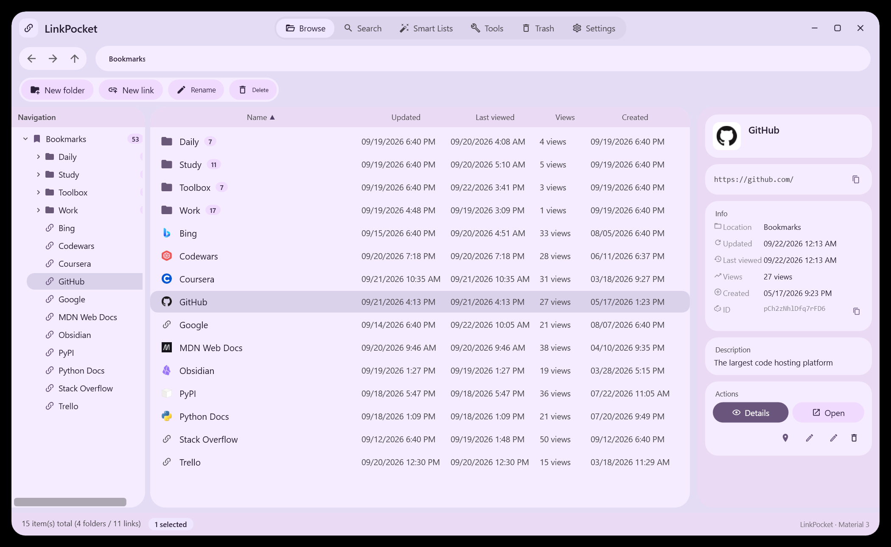

# LinkPocket

A local-first bookmark manager for Windows. Your links live in one folder on your machine — no account, no sync service, no telemetry — and everything about them (organizing, searching, cleaning up, backing up) happens in one place.



## Features

**Organize**

- Folder trees of any depth; drag bookmarks and folders anywhere, and reorder items within a folder.
- Select many items at once to move, copy, delete or export them in one step.
- Rename in place, navigate with Back / Forward / Up, and edit the path directly in the address bar.

**Find**

- Search the title, the address, your notes or the folder path — individually or together; each hit shows which field matched.
- Smart Lists need no setup: recently added, recently visited, recently edited, most visited.
- Jump to a bookmark by its ID, or from any list to the folder it belongs to.

**Recycle bin**

- Deleting a bookmark or a folder moves it to the Recycle Bin together with its original location.
- Restore an item where it came from, restore a deleted folder as one unit, or place it somewhere else on purpose.
- If the original folder no longer exists, LinkPocket says so and puts the item at the top level rather than guessing.

**Clean up**

- The duplicate finder groups bookmarks that share the same address and lets you keep the one you want; the others go to the Recycle Bin.

**Import, export and backup**

- Import standard bookmark files exported by any browser, and export them back out at any time.
- Export as JSON or CSV for use elsewhere.
- Back up the whole library to a single file — descriptions, visit counts, favorites and site icons included; a backup is verified when written and validated before it is restored.

**Undo**

- Every edit can be undone and redone.

**Large libraries**

- Tens of thousands of bookmarks stay responsive.

**Appearance**

- 11 built-in themes, plus a color studio that derives the interface from a palette of your own.
- Import your own font files and use them across the app.
- Simplified Chinese and English, following the display language by default and switchable at any time.

**AI assistant (optional)**

- Works through the same operations as the interface, under the same rules: read-only calls pass through, reversible writes are recorded, and destructive steps ask first with a preview of their impact.
- Batches can be undone like any other edit.
- Conversations go only to the model provider you configure; history and the action log stay in your library folder.

**Command line and MCP (optional)**

- A command-line client and an MCP server ship alongside the app, so scripts and external AI tools can read and change the same library.

## Getting started

1. Download the latest release for Windows.
2. Extract the archive anywhere — a normal folder, a USB stick, a synced drive.
3. Run `LinkPocket.exe`.

There is no installer and nothing to configure. Your library (database, settings, site icons and logs) is created in the folder you extracted, so uninstalling means deleting that folder, and moving your library means moving it.

To use the AI assistant, add a model provider in **Settings → AI** (an OpenAI-compatible endpoint, OpenAI Responses, or Anthropic Messages) and paste your API key. It is stored locally, encrypted.

**Requirements:** Windows 10 or Windows 11 (64-bit).

## Data and privacy

- Your bookmarks never leave your machine unless you export them yourself.
- LinkPocket keeps no account and sends no usage data.
- The app uses the network only to serve you: it fetches the title, description and icon of a page when you add or open a bookmark's details, and it can look up a site's icon from an icon provider when the site itself does not offer one.
- AI conversations go only to the model provider you configure, from your machine, with your key.

## Building from source

Requires the .NET SDK.

```powershell
dotnet build LinkPocket.sln -c Release
dotnet run --project src/LinkPocket.App -c Release
dotnet test LinkPocket.sln -c Release
```

## Credits

- Icons: [Pictogrammers Material Design Icons](https://pictogrammers.com/library/mdi/) (Apache License 2.0).

## License

[MIT](LICENSE) © 2026 Hrecer
